# CTRL_ZERO 주행 시뮬레이터 — 어떻게 만들었나

**제4회 성균관대학교 AI자율주행경진대회(SW부문)** 에 출전한 차량(유아용 전동차를 개조한 차)과 대회 트랙을 **MuJoCo** 물리 엔진 위에 그대로 옮겨 만든 시뮬레이터입니다.
실차에서 돌리는 `main.py`의 차선 주행·주차 코드를 **한 줄도 고치지 않고** 시뮬레이션 안에서 그대로 실행해 볼 수 있습니다.

트랙 도면, 차량 치수, 카메라·LiDAR 위치처럼 시뮬레이션에 들어간 값은 모두 **근거 자료(대회 규정집, 상품 사진, 실측, 하드웨어 사양)** 에서 나왔습니다. 측정하지 않은 값을 그럴듯하게 채워 넣는 대신 `null`로 남겨 두고, 그런 값이 있으면 실행을 막도록 만들었습니다.

<table>
<tr>
<td width="50%">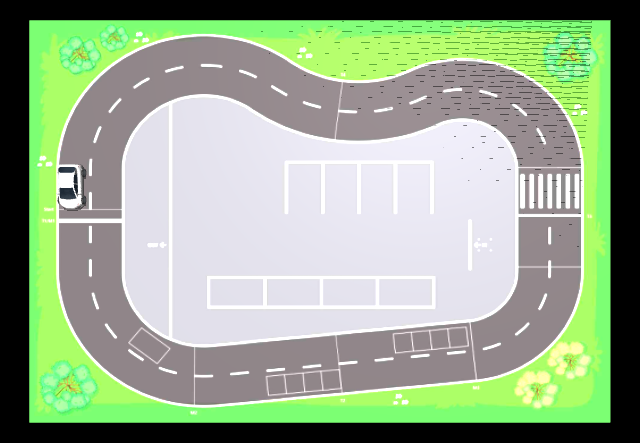</td>
<td width="50%">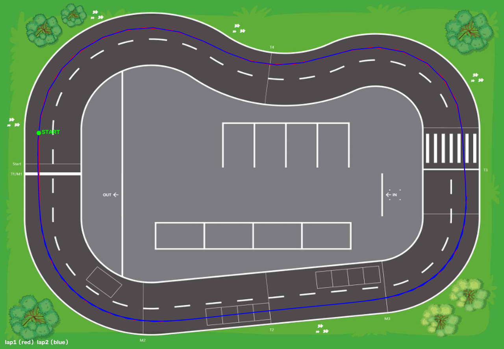</td>
</tr>
<tr>
<td align="center">MuJoCo로 재현한 대회 트랙과 출발 위치의 차량</td>
<td align="center"><code>main.py</code> 차선 인식 코드로 자율 주행한 2바퀴 궤적 (빨강 1랩, 파랑 2랩)</td>
</tr>
</table>

---

## 목차

1. [한눈에 보기](#한눈에-보기)
2. [맵: 대회 측 트랙 도면으로 만들기](#1-맵-대회-측-트랙-도면으로-만들기)
3. [차량: 유아용 전동차를 디지털로 옮기기](#2-차량-유아용-전동차를-디지털로-옮기기)
4. [카메라: 실차 시점 맞추기](#3-카메라-실차-시점-맞추기)
5. [LiDAR: 주차 미션용 센서](#4-lidar-주차-미션용-센서)
6. [main.py를 그대로 돌리는 구조](#5-mainpy를-그대로-돌리는-구조)
7. [검증 결과](#6-검증-결과)
8. [만들면서 부딪힌 문제와 해결](#7-만들면서-부딪힌-문제와-해결)
9. [남아 있는 한계](#8-남아-있는-한계)
10. [폴더 구조와 실행 방법](#9-폴더-구조와-실행-방법)

---

## 한눈에 보기

| 항목 | 근거 자료 | 시뮬레이션 값 |
|---|---|---|
| 트랙 맵 | 대회 규정집의 트랙 도면 이미지 + 치수 도면 | 15.09 × 10.44 m, 4096 px 바닥 텍스처 |
| 차체 크기 | 상품 크기 정보 (99 × 55 × 41 cm) | 0.99 × 0.55 × 0.41 m |
| 축간거리 · 바퀴 | 차량 옆모습 상품 사진에서 6개 점 측정 | 축간거리 0.603 m, 바퀴 반지름 95.6 mm |
| 윤거 · 바퀴 폭 | 차량 정면 상품 사진 | 윤거 0.47 m, 바퀴 폭 0.08 m |
| 외형 3D 메쉬 | 내려받은 실제 자동차 CAD 모델 | 측정 치수에 맞춰 구간별로 늘리고 줄임 |
| 조향 | 조향 포텐셔미터 사양 + 아두이노 펌웨어 | 최대 조향각 ±18.08°, PID·slew 그대로 |
| 속도 | 실차 1랩 기록(47~48초) 역산 | PWM 255 = 0.778 m/s |
| 카메라 | 직접 찍은 개조 차량 사진 + 카메라 뷰 비교 | 높이 0.80 m, 뒷차축 앞 0.067 m, 아래로 17° |
| LiDAR | 범퍼 어댑터 STL 치수 + `lidar.py` 각도 규약 | 뒷차축 앞 0.87 m, 1° 간격, 최대 12 m, 10 Hz |
| 주행 코드 | 실차 `main.py` | 수정 없이 import 해서 사용 |

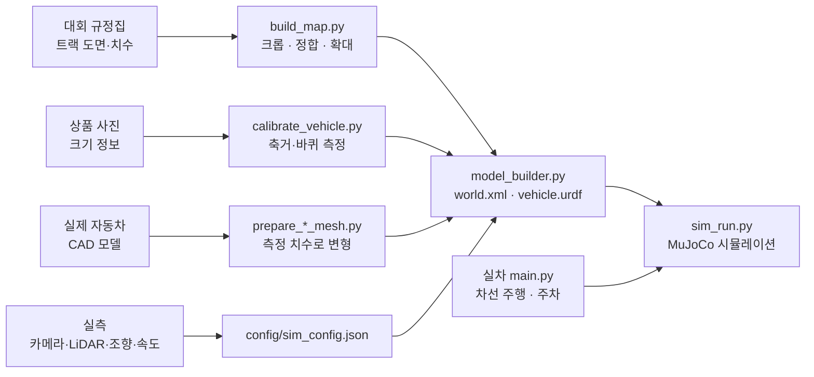

---

## 1. 맵: 대회 측 트랙 도면으로 만들기

### 1-1. 원본 자료

대회 규정집(`documents/` 폴더의 규정집 4.1절 "트랙 도면")에 실린 트랙 이미지와 치수 도면, 주요 치수표를 그대로 사용했습니다.

<table>
<tr>
<td width="40%">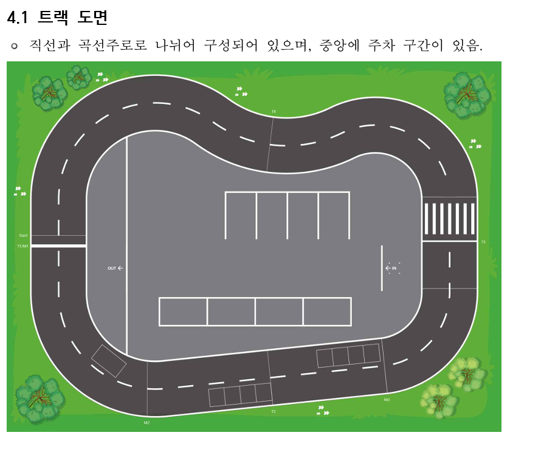</td>
<td width="25%">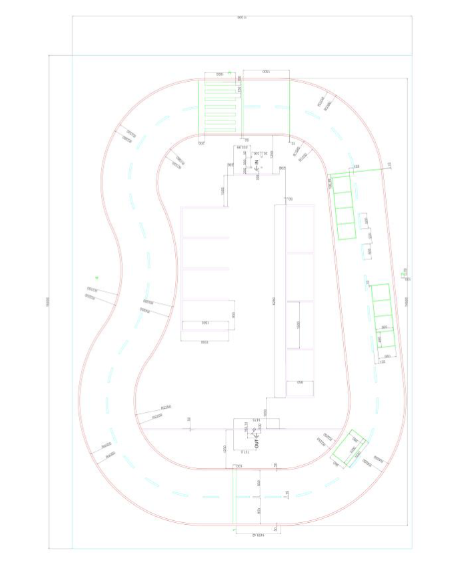</td>
<td width="35%">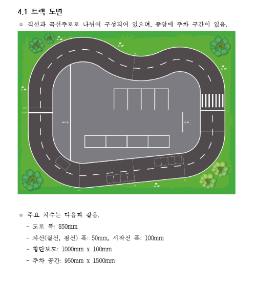</td>
</tr>
<tr>
<td align="center">① 컬러 트랙 이미지<br/><sub>바닥 텍스처로 사용</sub></td>
<td align="center">② 치수 도면<br/><sub>외곽 프레임·선 위치 정합용</sub></td>
<td align="center">③ 주요 치수<br/><sub>도로 폭 850 mm, 차선 50 mm,<br/>횡단보도 1000×100 mm, 주차 칸 950×1500 mm</sub></td>
</tr>
</table>

### 1-2. 텍스처 만들기 (`build_map.py`)

1. 컬러 이미지에서 트랙 영역만 잘라냅니다 (814 × 610 px).
2. 치수 도면은 방향이 달라서 시계 방향으로 90° 돌린 뒤, 도면의 외곽 프레임 네 모서리를 컬러 이미지의 네 모서리에 맞춰 **정합**합니다.
3. Lanczos 보간으로 **4096 × 2836 px** 고해상도 바닥 텍스처를 만듭니다.
4. 정합이 맞는지 확인하려고, 치수 도면의 선(마젠타)을 텍스처 위에 겹친 미리보기도 함께 생성합니다.

<p align="center">
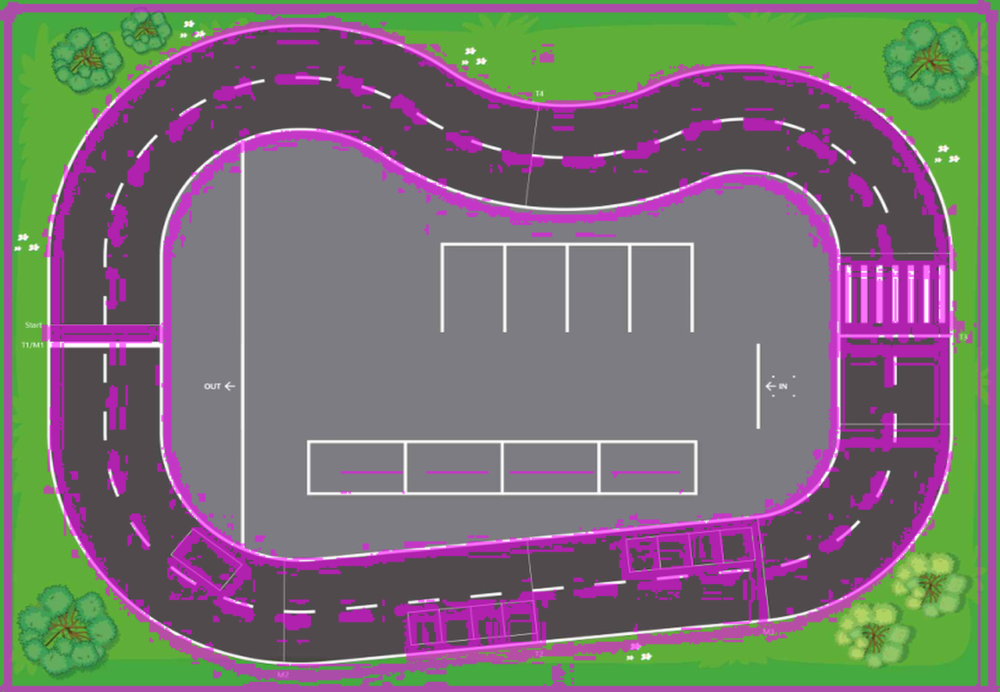<br/>
<sub>정합 확인 이미지: 마젠타 선이 치수 도면, 바탕이 바닥 텍스처 (원본 해상도: <code>assets/generated/track_alignment_preview.png</code>)</sub>
</p>

### 1-3. 실제 크기 보정: 13 × 9 m → 15.09 × 10.44 m

처음에는 도면 외곽 치수대로 맵을 **13 × 9 m**로 만들었습니다. 그런데 완성된 텍스처 위에서 도로 폭을 실제로 재 보니, 규정상 850 mm여야 할 도로가 **약 732.5 mm**밖에 되지 않았습니다. 그림 속 트랙 요소들이 일정하게 14~25% 작게 그려져 있었던 겁니다.

그래서 도로 폭(차선 중심선 사이 거리)을 기준으로 배율 **k = 850 / 732.5 = 1.1604**를 구하고, 서로 관계없는 다른 규격으로도 같은 배율이 나오는지 교차 검증했습니다.

| 기준 | 규정집 값 | 구한 배율 k |
|---|---|---|
| 도로 폭 (기준값) | 850 mm | **1.160** |
| 주차 칸 간격 | 950 mm | 1.170 |
| 횡단보도 줄 폭 | 100 mm | 1.163 |

세 값이 거의 일치해서 맵 전체를 같은 비율로 키웠고, 최종 크기는 **15.085 × 10.444 m**가 되었습니다. 확대한 뒤 맵에 그려진 주차 시작 마커(규정상 3 cm)를 다시 재 보니 29~33 mm로 나와서, 보정이 맞다는 것도 한 번 더 확인했습니다.

> 단, 원본 그림 자체가 선을 굵게 그려 놓아서 차선 굵기는 시뮬레이션에서 약 59 mm로 보입니다 (규정 50 mm).

### 1-4. 출발 위치

차량은 왼쪽 직선 구간 바깥 차선의 Start 라인 앞에 놓이고, 반시계 방향으로 출발합니다. 차량 위치는 **뒷차축 중심**을 기준으로 기록하며, 맵 중앙이 원점입니다.

<p align="center">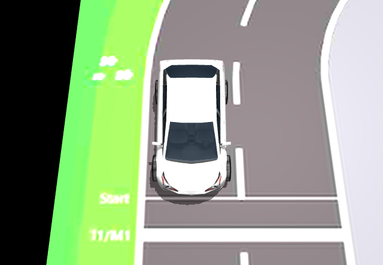</p>

---

## 2. 차량: 유아용 전동차를 디지털로 옮기기

대회 차량은 **벤츠 AMG GT R 유아용 전동차**를 개조한 것입니다. 장난감이라 제조사 도면이 없어서, **상품 사진에서 치수를 직접 뽑아내는 방식**으로 차량을 재현했습니다. 같은 모델의 옆모습·정면 사진은 해외(베트남) 쇼핑몰을 한참 뒤져서 겨우 찾았습니다.

<table>
<tr>
<td width="33%">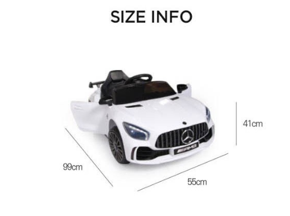</td>
<td width="33%">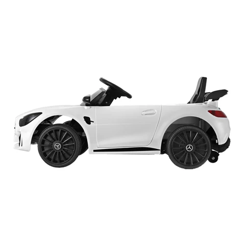</td>
<td width="33%">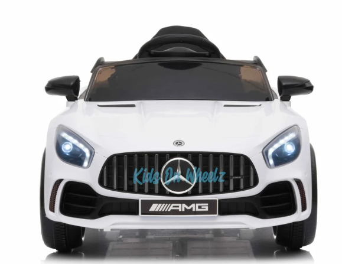</td>
</tr>
<tr>
<td align="center">상품 크기 정보<br/><sub>99 × 55 × 41 cm → 길이 기준값</sub></td>
<td align="center">옆모습 사진<br/><sub>축간거리·바퀴 크기 측정</sub></td>
<td align="center">정면 사진<br/><sub>윤거·바퀴 폭 추정</sub></td>
</tr>
</table>

### 2-1. 축간거리·바퀴 크기 측정 (`calibrate_vehicle.py`)

사진 위에서 점을 찍으면 실제 길이로 바꿔 주는 GUI 도구를 만들었습니다. 옆모습 사진에서 **차체 앞·뒤 끝**과 **앞·뒷바퀴의 중심, 둘레** 총 6개 점을 찍으면 다음 순서로 계산합니다.

1. 차체 앞 끝에서 뒤 끝까지가 사진에서 440 px이고 실제로는 0.99 m이므로, **1 px = 2.25 mm**로 환산합니다.
2. 바퀴 중심을 차체 길이 방향 축에 투영해서 앞·뒤 차축 위치를 구합니다.
3. 바퀴 중심에서 둘레까지 거리로 앞·뒷바퀴 반지름을 각각 구하고 평균을 냅니다.

<p align="center">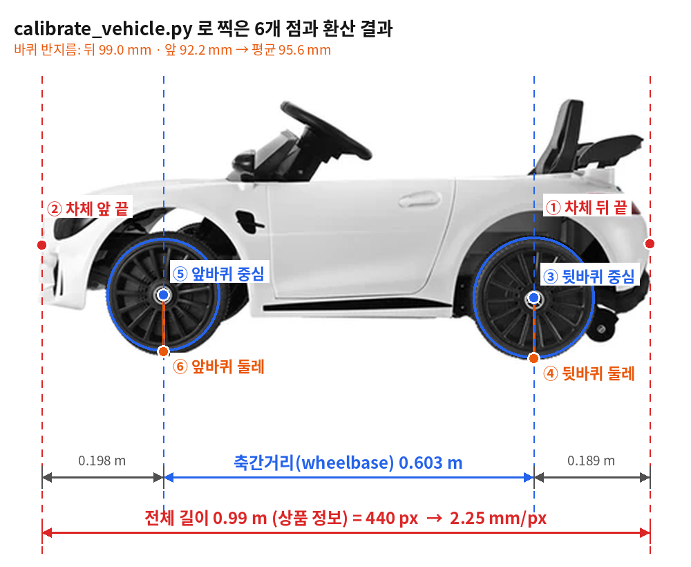</p>

| 결과 | 값 |
|---|---|
| 뒤 끝 → 뒷차축 | 0.189 m |
| 뒤 끝 → 앞차축 | 0.792 m |
| **축간거리 (wheelbase)** | **0.603 m** |
| 바퀴 반지름 | 뒤 99.0 mm, 앞 92.2 mm → 평균 **95.6 mm** |
| 윤거 (좌우 바퀴 중심 간격) | 0.47 m (정면 사진과 전체 폭 0.55 m 비교) |
| 바퀴 폭 | 0.08 m |

측정값과 함께 "사진 한 장으로는 원근 왜곡을 완전히 없앨 수 없다"는 한계도 `config/vehicle_geometry.json`에 같이 기록해 두었습니다.

### 2-2. 외형 3D 메쉬: 실제 자동차 CAD를 측정 치수에 맞추기

겉모습은 인터넷에서 내려받은 실제 자동차 CAD 모델을 썼습니다. 실제 자동차와 유아용 차는 비율이 다르기 때문에, 그냥 크기만 줄이면 바퀴 위치가 어긋납니다. 그래서 **뒤 끝 · 뒷차축 · 앞차축 · 앞 끝** 네 지점을 측정값에 고정하고, 그 사이 구간을 각각 따로 늘리거나 줄이는 **구간별 선형 변형**을 적용했습니다. 폭과 높이는 0.55 m, 0.41 m에 맞추고, 바퀴는 바퀴마다 떼어 내 측정한 반지름과 폭으로 다시 맞췄습니다.

<table>
<tr>
<td width="50%">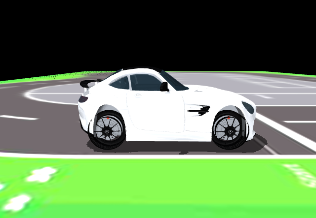</td>
<td width="50%">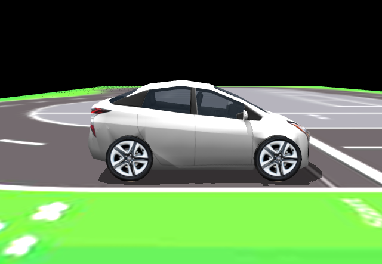</td>
</tr>
<tr>
<td align="center"><b>1차</b>: 실제 차와 같은 차종인 AMG GT R CAD(FBX)를<br/>Blender에서 변형 (<code>prepare_vehicle_mesh.py</code>)<br/><sub>삼각형 689,536개 · 약 93 MB</sub></td>
<td align="center"><b>현재</b>: Gazebo 공개 모델 Prius Hybrid를<br/>같은 방식으로 변형 (<code>prepare_prius_mesh.py</code>)<br/><sub>삼각형 1,980개 · 약 0.25 MB</sub></td>
</tr>
</table>

메쉬는 **보기용**입니다. 실제 움직임과 센서 위치는 모두 위에서 측정한 치수로 계산합니다.

### 2-3. URDF / MuJoCo 모델 생성 (`model_builder.py`)

측정한 치수를 읽어서 `vehicle.urdf`와 MuJoCo 월드 파일(`world.xml`)을 자동으로 만듭니다. 좌표계는 **뒷차축 중심 바로 아래 지면이 원점**이고 x는 앞, y는 왼쪽, z는 위쪽입니다. 차량 치수를 바꾸면 이 스크립트를 다시 돌리기만 하면 모델이 갱신됩니다.

### 2-4. 차량의 움직임 (`vehicle_kinematics.py`)

질량, 관성, 타이어 마찰 같은 값은 잴 수 없었기 때문에, 지어낸 물리 값을 넣는 대신 **측정한 값만으로 계산되는 운동학 자전거 모델(kinematic bicycle model)** 을 썼습니다. 좌우 앞바퀴 각도는 Ackermann 조향식으로 따로 계산합니다.

- **조향각**: 조향 포텐셔미터(ELB030640, 회전각 270°)를 펌웨어에서 왼쪽 573, 오른쪽 436으로 보정해 두었으므로, 137 count ÷ 1023 × 270° = 36.16°를 좌우로 나눠 **최대 ±18.08°** 로 잡았습니다 (포텐셔미터와 바퀴가 1:1로 돌아가는 것은 실차에서 확인).
- **조향 응답**: 아두이노 펌웨어의 PID 값, 명령 변화 속도 제한(초당 900), 명령 범위(−100~100)를 그대로 옮겼습니다.
- **속도**: 처음에는 실차가 PWM 255로 1 m를 1.75초에 가는 것을 재서 0.571 m/s로 넣었는데, 이 값은 출발할 때 가속하는 구간이 포함돼 실제 주행 속도보다 낮았습니다. 그래서 **실차 1랩 기록(47~48초)** 과 시뮬레이션 바깥 차선 1랩 경로 길이(36.96 m)로 역산해 **0.778 m/s**로 다시 맞췄습니다.
- 후륜 구동, PWM 0이면 제동, PWM ±8 이하는 무출력 구간 등 펌웨어 동작도 그대로 반영했습니다.

---

## 3. 카메라: 실차 시점 맞추기

차선 인식은 카메라 영상에 의존하기 때문에, 시뮬레이션 카메라가 실차와 같은 위치·각도에서 같은 장면을 봐야 의미가 있습니다.

<p align="center">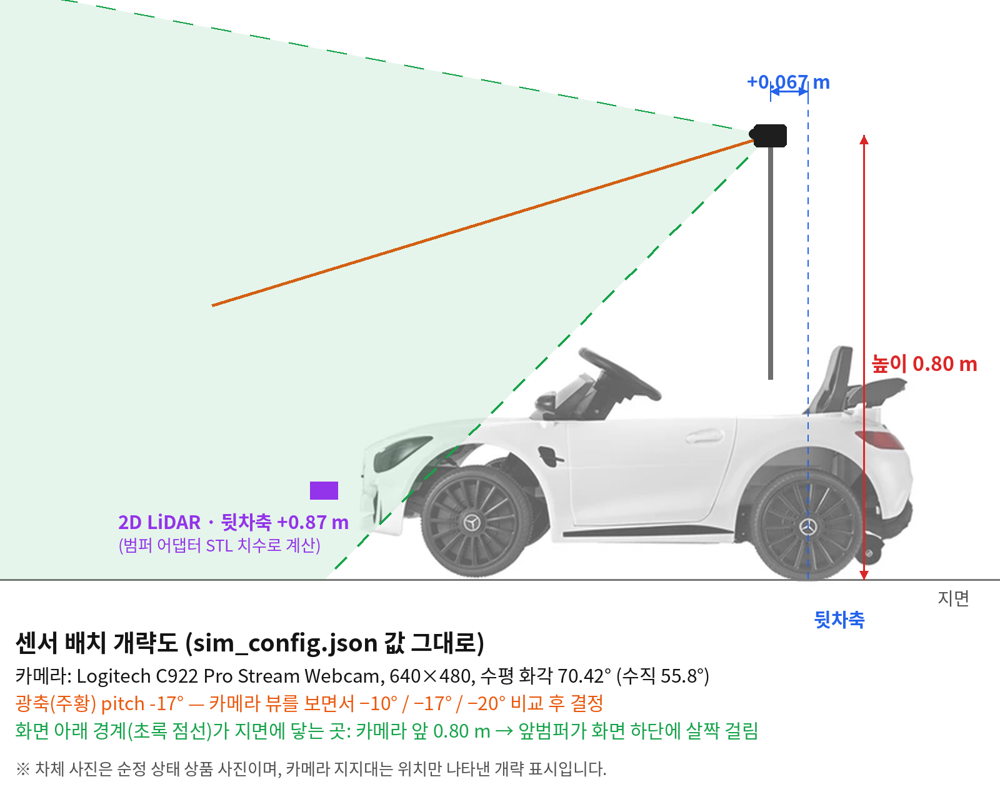</p>

| 항목 | 값 | 어떻게 정했나 |
|---|---|---|
| 카메라 | Logitech C922, 640×480, 30 fps | 실차와 같은 모델·해상도 |
| 수평 화각 | 70.42° | 제조사 사양 |
| **높이** | **0.80 m** | 개조 차량을 직접 찍은 사진 기준, 지면에서 렌즈까지 |
| **앞뒤 위치** | **뒷차축보다 0.067 m 앞** | 같은 옆모습 사진에서 렌즈가 뒷차축보다 약 81 px 앞, 두 차축 사이가 약 727 px → 81/727 × 0.603 m |
| 좌우 위치 · 방향 | 차량 중앙, 정면 | 실차 장착 상태 |
| **아래 방향 각도 (pitch)** | **−17°** | 시뮬레이션 카메라 뷰를 직접 보면서 −10°, −17°, −20°를 비교 → 실차 카메라 화면처럼 **앞 범퍼가 화면 아래에 살짝 걸리는** −17°로 결정 |

이렇게 맞춘 카메라 화면을 실차와 같은 차선 인식 모델(`models/final_openvino_model`, OpenVINO 변환 YOLO 분할 모델)에 그대로 넣어 인식이 되는지 확인했습니다 (`lane_detect_preview.py`).

<table>
<tr>
<td width="50%">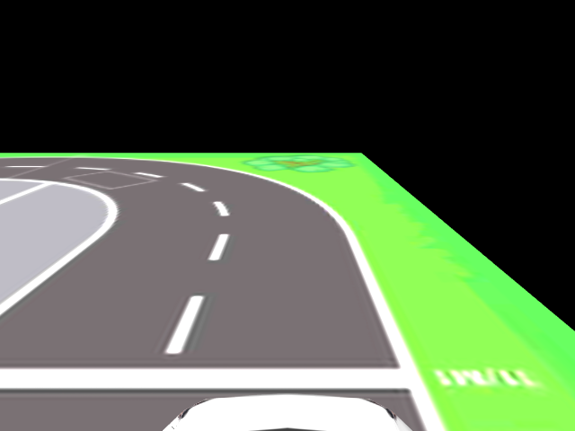</td>
<td width="50%">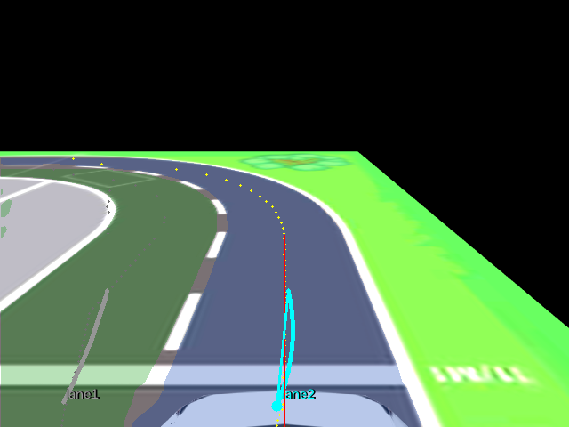</td>
</tr>
<tr>
<td align="center">시뮬레이션 온보드 카메라 화면 (640×480)<br/><sub>화면 아래쪽에 차량 앞부분이 살짝 보임</sub></td>
<td align="center">같은 화면을 <code>main.py</code> 차선 인식 파이프라인에 넣은 결과<br/><sub>인식한 차선 영역과 주행 목표 경로</sub></td>
</tr>
</table>

---

## 4. LiDAR: 주차 미션용 센서

주차 미션에서는 2D LiDAR로 옆에 세워진 장애물 차량을 감지합니다.

- **장착 위치**: 앞 범퍼에 다는 어댑터(`LD_Adaptor.stl`, 120 × 80 × 25 mm)의 치수를 재 보니 센서 회전 중심이 어댑터 고정면보다 69 mm 앞에 있었습니다. 차체 앞 끝(뒷차축에서 0.801 m)에 69 mm를 더해 **뒷차축 앞 0.87 m, 좌우 중앙**으로 잡았습니다.
- **각도 규약**: 실차 코드 `ctrl_zero/lidar.py`와 똑같이 원시 각도 180°가 정면이고 `ros = 180 − raw`입니다. 이 규약은 실차에서 `lidar_probe.py`로 직접 확인했습니다.
- **시뮬레이션 방식** (`lidar_sim.py`): 1° 간격으로 광선을 쏘아 장애물 차량 사각형과 만나는 거리를 계산합니다 (최대 12 m, 10 Hz). 실제 센서처럼 맞은 광선만 결과로 돌려줍니다.
- 장애물 차량은 규정대로 주차 칸 2·4번(케이스 1) 또는 1·3번(케이스 2)에 자기 차와 같은 크기(0.99 × 0.55 m)로 배치합니다.

---

## 5. main.py를 그대로 돌리는 구조

시뮬레이터는 실차 코드를 흉내 내는 별도 코드가 아니라, **실차의 `main.py`를 import 해서 그대로 호출**합니다. 그래서 시뮬레이션에서 검증한 로직이 실차 코드와 같습니다.

```
MuJoCo 온보드 카메라 렌더링 (640×480)
        │
        ▼
main.py 차선 인식 + DriveController   ← 실차와 같은 코드
        │  조향 명령(-100~100), PWM(-255~255)
        ▼
펌웨어 규칙 적용 (조향 속도 제한, 무출력 구간, 제동)
        │
        ▼
운동학 자전거 모델 + Ackermann → 차량 위치 갱신 → mj_step()
```

- **수동 모드**: 실차와 같은 키 조작(W/S 속도, A/D 조향, Space 정지).
- **자동 모드**: 차선 인식 기반 주행 + 장애물 미션 경로.
- **주차 모드**: 시뮬레이션 LiDAR 스캔을 `main.py`의 주차 미션(`ParkingHardMission`, `TimedParkingMission`)에 공급.
- `main.py`, `arduino/`, `models/`는 **읽기만** 하고, 시뮬레이터가 만드는 파일은 전부 `sim/` 안에만 쓰도록 `scope_guard.py`와 테스트로 강제했습니다.

---

## 6. 검증 결과

### 6-1. 자율 주행 랩타임

`main.py` 차선 인식 코드로 트랙을 2바퀴 자율 주행했을 때 1랩 기록이 **47.6초**로, 실차 기록 **47~48초**와 맞았습니다. 맵 크기 보정과 속도 역산이 서로 맞물려 맞아떨어졌다는 뜻입니다. (궤적 이미지는 맨 위 참고)

### 6-2. 수직 주차

시작 마커 4곳 × 장애물 배치 2가지 = **8개 조합** 모두에서 주차에 성공했고, 최종 결과는 다음과 같습니다.

- 차량 방향 오차: 수직 기준 **±1.3° 이내**
- 주차 칸 중심 대비 좌우 오차: **3.8 cm 이내**

<p align="center">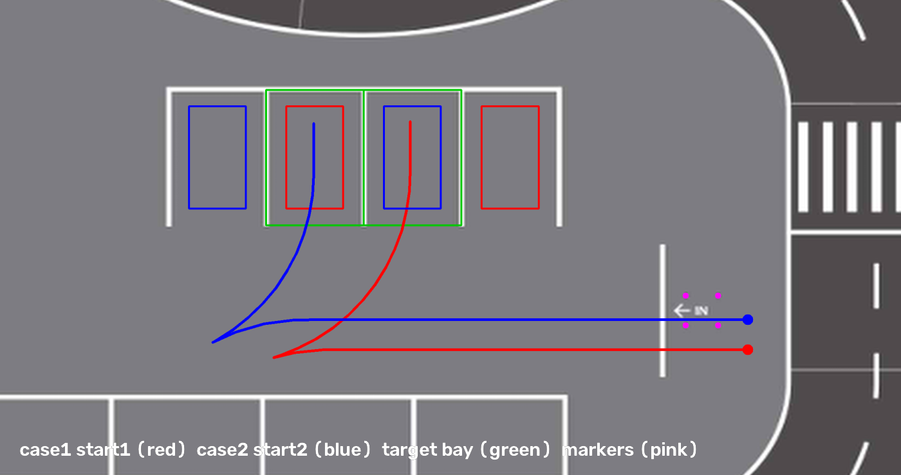<br/>
<sub>빨강: 케이스 1·마커 1, 파랑: 케이스 2·마커 2, 초록: 목표 주차 칸, 분홍: 시작 마커</sub></p>

### 6-3. 자동 테스트

맵 정합, 사진 투영 계산, PWM-속도 보간, 조향 속도 제한, Ackermann 계산, 누락값 차단, 주차 시나리오 등을 검사하는 **pytest 150개**가 모두 통과합니다 (`sim/test.ps1`).

---

## 7. 만들면서 부딪힌 문제와 해결

| 문제 | 해결 |
|---|---|
| 유아용 전동차라 **도면이 없음** | 상품 크기 정보(99 cm)를 기준 길이로 삼아 사진 속 픽셀을 실제 길이로 바꾸는 측정 GUI를 만들어 축간거리·바퀴 크기를 구함 |
| 실제 자동차 CAD와 유아용 차의 **비율이 다름** | 앞·뒤 끝과 앞·뒷차축 4개 지점을 고정하고 구간별로 따로 늘리고 줄여서, 바퀴 위치가 측정값과 정확히 맞도록 변형 |
| 공식 도면대로 만든 **맵이 실제보다 작았음** | 텍스처 위에서 도로 폭을 재서 규정값과 비교 → 배율을 구하고, 주차 칸 간격·횡단보도 폭으로 교차 검증한 뒤 맵 전체를 1.16배 확대 |
| 짧은 거리로 잰 **속도가 실제보다 낮게 나옴** | 출발 가속 구간이 섞인 1 m 측정 대신, 실차 1랩 기록을 경로 길이로 역산해 속도를 다시 맞춤 → 시뮬레이션 랩타임이 실차와 일치 |
| 카메라 **위치·각도를 정확히 재기 어려움** | 직접 찍은 개조 차량 사진으로 높이를 맞추고, 앞뒤 위치는 사진 속 축간거리(0.603 m) 비율로 계산, 각도는 시뮬레이션 카메라 화면을 보며 실차처럼 범퍼가 살짝 보이도록 결정 |
| 기존 주차 코드가 수직 주차에서 **멈춰 버림** | 시뮬레이션에서 원인을 찾고, 두 번째 장애물 차량 감지를 기준으로 하는 시간 기반 주차 방식으로 바꿔 시작 위치 4곳 모두 하나의 설정으로 성공 |

---

## 8. 남아 있는 한계

측정하지 않은 값은 지어내지 않는다는 원칙 때문에, 다음 부분은 단순화되어 있습니다.

- 질량·관성·타이어 마찰을 모르기 때문에 동역학 대신 **운동학 모델**이고, 가속·제동은 즉시 반응합니다.
- 차축 위치는 **사진 한 장**에서 구해서 원근에 따른 오차가 남을 수 있습니다.
- 윤거·바퀴 폭은 정면 사진으로 **근사**한 값입니다.
- 맵 차선 굵기는 원본 그림 때문에 규정보다 약간 굵습니다 (59 mm vs 50 mm).
- LiDAR 정확한 모델명은 확인하지 못해 RPLidar A1급 사양(12 m, 1°, 10 Hz)을 가정했습니다.

---

## 9. 폴더 구조와 실행 방법

```
sim/
├── README.md                 ← 이 문서 (제작 과정)
├── USAGE.md                  ← 상세 실행·설정 가이드
├── config/
│   ├── sim_config.json       ← 맵·차량·카메라·LiDAR·펌웨어 값과 각 값의 근거(provenance)
│   ├── vehicle_geometry.json ← 사진 측정 결과 (찍은 점 좌표 포함)
│   └── vehicle_visual_mesh.json
├── assets/
│   ├── source/               ← 원본 자료 (규정집 트랙 도면, 상품 사진, CAD)
│   └── generated/            ← 생성 결과 (텍스처, URDF, world.xml, 미리보기)
├── docs/images/              ← 이 README용 설명 그림
├── build_map.py              ← 트랙 도면 → 바닥 텍스처
├── calibrate_vehicle.py      ← 사진에서 축간거리·바퀴 측정 GUI
├── prepare_vehicle_mesh.py   ← AMG GT R CAD 변형 (Blender)
├── prepare_prius_mesh.py     ← Prius 메쉬 변형
├── model_builder.py          ← URDF / MuJoCo 월드 생성
├── vehicle_kinematics.py     ← 운동학 자전거 모델 + Ackermann
├── lidar_sim.py              ← 2D LiDAR 레이캐스트
├── parking_scenario.py       ← 주차장 칸·장애물·시작 마커 배치
├── lane_detect_preview.py    ← 온보드 카메라 + 차선 인식 확인
├── sim_run.py                ← 시뮬레이션 실행 (main.py 연동)
└── tests/                    ← pytest
```

자주 쓰는 명령 (Windows PowerShell, 저장소 루트에서 실행):

```powershell
.\sim\setup.ps1 -Auto                       # sim/.venv 환경 구성 (차선 인식 의존성 포함)
python -B .\sim\preview_scene.py            # 맵과 출발 자세 미리보기 이미지 생성
.\sim\run.ps1 --mode manual                 # 키보드로 직접 운전
.\sim\run.ps1 --mode auto                   # main.py 차선 인식으로 자율 주행
.\sim\test.ps1                              # 테스트 실행

# 수직 주차 (장애물 배치 1|2, 시작 마커 1~4)
.\sim\run.ps1 --mode parking --parking-strategy timed --parking-case 1 --parking-start 1
```

옵션 설명, 설정 항목, 주차 파라미터 등 자세한 내용은 [USAGE.md](USAGE.md)를 참고하세요.

---

### 자료 출처

- **트랙 도면 · 치수**: 제4회 성균관대학교 AI자율주행경진대회(SW부문) 규정집 ver2.0 4.1절 (`documents/` 폴더)
- **차량 크기 · 옆모습 · 정면 사진**: 같은 모델(벤츠 AMG GT R 유아용 전동차)을 판매하는 쇼핑몰 상품 이미지
- **차량 CAD**: 온라인에서 내려받은 AMG GT R 3D 모델(FBX), Gazebo 공개 모델 Prius Hybrid (OSRF)
- **카메라 사양**: Logitech C922 Pro Stream Webcam 제조사 사양
- **하드웨어 값**: `arduino/CTRL_ZERO_Controller/CTRL_ZERO_Controller.ino`, `ctrl_zero/lidar.py`, 실차 실측
